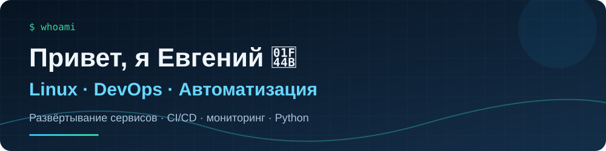

<div align="center">



### 🖥️ Linux · DevOps · Автоматизация

Развёртываю и сопровождаю сервисы, настраиваю инфраструктуру и автоматизирую рутинные процессы.

[](https://github.com/emikoff)

</div>

---

### `emikoff@github:~$ whoami`

```text
> Инженер с практическим опытом эксплуатации Linux и развёртывания сервисов.
> Работаю с контейнерами, веб-серверами, CI/CD и мониторингом.
> Использую Python для автоматизации и создания прикладных инструментов.
> Изучаю новые технологии и развиваю собственные проекты.
```

### ⚙️ Инструменты и технологии

**Инфраструктура**


**Разработка и данные**


**Мониторинг и автоматизация**


### 📂 Избранные проекты

| Проект | Что сделано | Технологии |
|:--|:--|:--|
| **Kama-book** | Развёртывание и сопровождение сервиса бронирования переговорных комнат, HTTPS и автоматизация доставки изменений | Docker, Nginx, GitHub Actions, Go (стек приложения) |
| **ExamTrainer** | Telegram-бот для подготовки к экзаменам с банком вопросов и хранением результатов | Python, PostgreSQL, Docker |
| **Linux Monitoring** | Сбор метрик, мониторинг Linux и визуализация состояния инфраструктуры | Prometheus, Grafana, Linux |
| **AI-Профилирование** | Развёртывание веб-сервиса профориентации на собственном сервере | Docker, Nginx, HTTPS |

> Некоторые проекты находятся в приватных репозиториях. Описание отражает выполненные задачи; ссылки добавлю после публикации исходного кода.

### 🚀 Публичные репозитории

- [shift_generator](https://github.com/emikoff/shift_generator) — генератор сменных графиков.
- [Deribit-tracker-with-Celery-and-Docker](https://github.com/emikoff/Deribit-tracker-with-Celery-and-Docker) — проект с контейнеризацией и фоновыми задачами.
- [iva-connect-install](https://github.com/emikoff/iva-connect-install) — скрипты установки.

### 📊 Активность GitHub

<div align="center">


</div>

---

<div align="center">

**Интересуюсь Linux-инфраструктурой, DevOps, автоматизацией и разработкой полезных сервисов.**

`git status` → `always learning`

</div>
