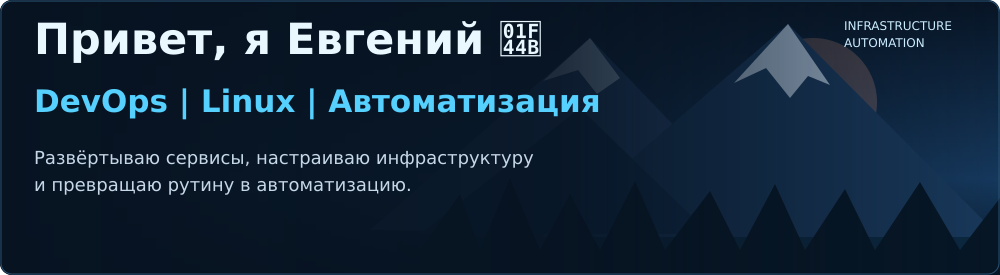
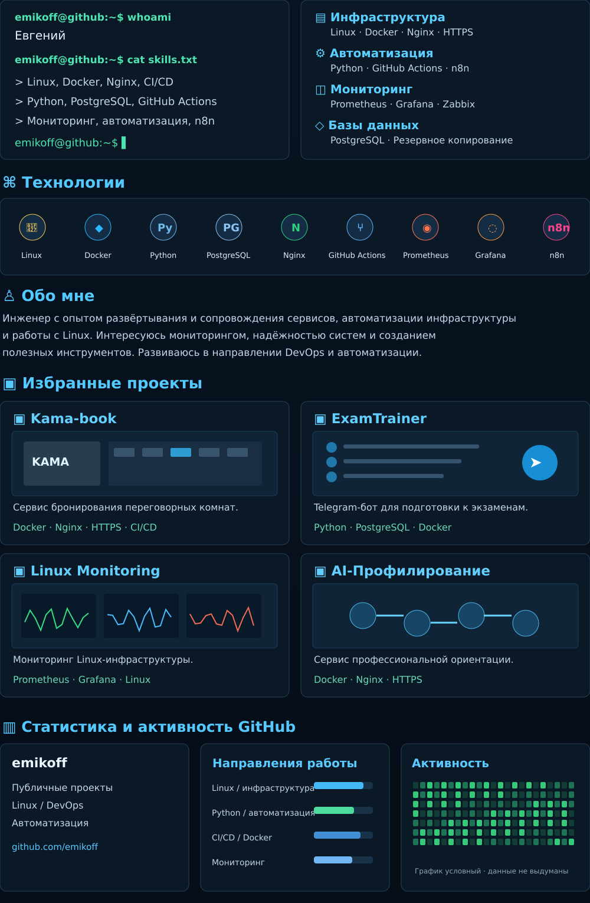

🔗 Ссылки на публичные репозитории

- [shift_generator](https://github.com/emikoff/shift_generator)
- [Deribit-tracker-with-Celery-and-Docker](https://github.com/emikoff/Deribit-tracker-with-Celery-and-Docker)
- [iva-connect-install](https://github.com/emikoff/iva-connect-install)

ℹ️ Подробнее о проектах

**Kama-book** — сервис бронирования переговорных комнат. Моя роль: Docker, Nginx, HTTPS, CI/CD и сопровождение инфраструктуры. Приложение использует Go, но я не позиционирую себя как Go-разработчик.

**ExamTrainer** — Telegram-бот для подготовки к экзаменам с PostgreSQL.

**Linux Monitoring** — мониторинг инфраструктуры на Prometheus и Grafana.

**AI-Профилирование** — развёртывание сервиса профориентации.

Часть проектов находится в приватных репозиториях. Визуальные панели — иллюстрации, а не реальные скриншоты интерфейсов или статистика GitHub.

