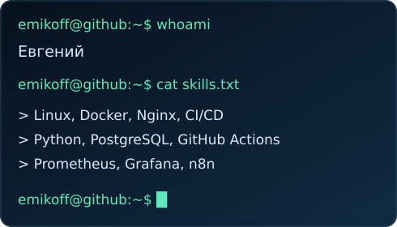
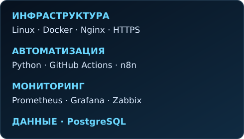
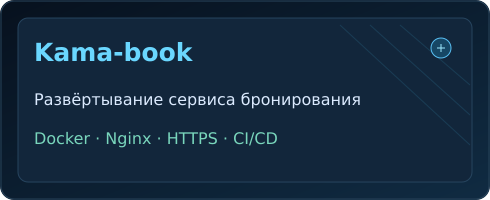
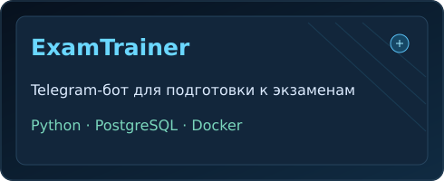
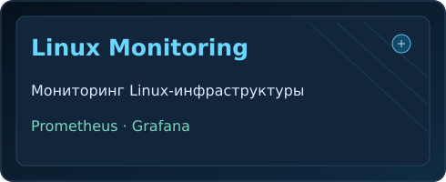
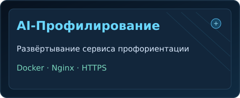

<table><tr><td width="50%"></td><td width="50%"></td></tr></table>

### ⚙️ Технологии

### 👤 Обо мне

Инженер с опытом развёртывания и сопровождения сервисов, автоматизации инфраструктуры и работы с Linux. Интересуюсь мониторингом, надёжностью систем и созданием полезных инструментов. Развиваюсь в направлении DevOps и автоматизации.

### 📁 Избранные проекты

<table>
<tr><td width="50%"></td><td width="50%"></td></tr>
<tr><td width="50%"></td><td width="50%"></td></tr>
</table>

> Это проекты из моего опыта. Часть исходного кода находится в приватных репозиториях. В Kama-book приложение написано на Go, моя роль — развёртывание и DevOps.

### 🔗 Публичные репозитории

[shift_generator](https://github.com/emikoff/shift_generator) · [Deribit-tracker-with-Celery-and-Docker](https://github.com/emikoff/Deribit-tracker-with-Celery-and-Docker) · [iva-connect-install](https://github.com/emikoff/iva-connect-install)

### 📈 Активность GitHub

**Linux · DevOps · Автоматизация · Постоянное развитие**

